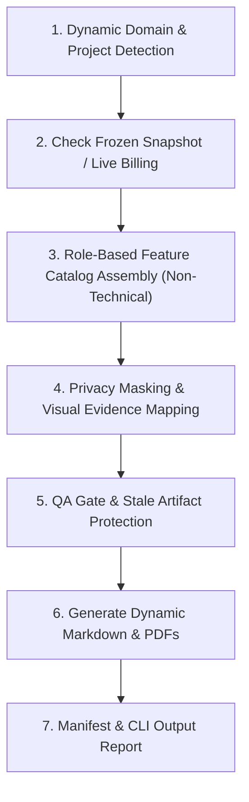

# Universal Evidence & Billing Package Generator (`/siasek-bos`)

Skill ini digunakan untuk membuat **Paket Dokumen Tagihan, Rincian Pemanfaatan Layanan, Daftar Lengkap Fitur Aplikasi Berdasarkan Role, dan Bukti Operasional Software** yang adaptif untuk berbagai jenis aplikasi:
1. **Aplikasi Presensi SIASEK** (Paket Dokumen Pendukung SPJ/LPJ BOSP SMP Negeri 1 Biau).
2. **Aplikasi Apotek Sehat** (Paket Bukti Layanan Manajemen Obat, POS Kasir, Resep Racikan, & Laba Rugi).
3. **Aplikasi SaaS / Laravel Lainnya** (Otomatis mendeteksi profil aplikasi dan model billing proyek).

> [!IMPORTANT]
> - Skill ini menghasilkan **PAKET BUKTI PENYEDIA / LAYANAN** resmi dari ZahraDev (Emil Salim, S.Kom).
> - Seluruh lampiran dokumen telah diformat **BEBAS DARI HAL-HAL TEKNIS** (tanpa git commit hash, tanpa path file source code, tanpa nama controller/middleware, tanpa raw route URL, dan tanpa tabel developer tooling).
> - Lampiran langsung memuat **DAFTAR SELURUH FITUR APLIKASI BERDASARKAN ROLE PENGGUNA** sehingga siap diaudit oleh Kepala Sekolah, Komite Sekolah, Dinas Pendidikan, dan Inspektorat BOSP.
> - **JANGAN** membuat bukti pembayaran. Bukti pembayaran dilampirkan oleh pihak pelanggan/sekolah/mitra.

---

## 1. Struktur Lampiran Bebas Hal Teknis (Role-Based Feature Catalog)

Pada dokumen lampiran `03_pembaruan_fitur` (Daftar Fitur Layanan) dan `05_evidence_index` (Indeks Bukti Operasional), hal-hal teknis dihilangkan dan digantikan dengan katalog fitur fungsional lengkap yang dikelompokkan berdasarkan hak akses pengguna (*role*):

### Daftar Pengelompokan Role SIASEK Presensi:
1. **Role Administrator & Operator Sekolah (Tata Usaha)**
   - Dashboard Statistik Kehadiran Real-Time
   - Manajemen Data Siswa & Alokasi Rombel
   - Pencetakan Kartu Tanda Siswa Ber-QR Code Presisi
   - Registrasi Wajah Siswa (Face Recognition)
   - Manajemen Pendidik & Tenaga Kependidikan (PTK)
   - Verifikasi & Persetujuan Akun Mandiri Orang Tua
   - Manajemen Tahun Ajaran & Kalender Pendidikan
   - Pengaturan Jadwal Pelajaran Mingguan
   - Intervensi Izin & Sakit Siswa Manual Terintegrasi
   - Penerbitan Surat E-Dispensasi Siswa & Pass Gerbang
   - Koreksi Kehadiran Resmi & Audit Trail BOSP
   - Monitoring Scanner & Log Presensi Masuk/Pulang
   - Rekapitulasi Laporan Presensi Lengkap (PDF & Excel)
   - Supervisi & Validasi Jurnal Mengajar Guru
   - Pengelolaan Kegiatan Ekstrakurikuler
   - Saluran Komunikasi Resmi Tata Usaha - Orang Tua
   - Pengaturan Geofencing Sekolah & Pencadangan Data Rutin

2. **Role Guru & Wali Kelas**
   - Dashboard Pengajar & Wali Kelas
   - Presensi Mata Pelajaran (Digital & Pemindai QR Mapel)
   - Jurnal Pembelajaran Guru Digital & Cetak Dokumen
   - Catatan Anekdot & Observasi Karakter Siswa
   - Validasi & Persetujuan Permohonan Izin Siswa Kelas Binaan
   - Rekapitulasi Kehadiran Triwulan & Semester (Lampiran Rapor)
   - Presensi Mandiri Pendidik (Wajah & Radius Koordinat)
   - Pencatatan Presensi Kegiatan Ekstrakurikuler
   - Konsultasi Interaktif Guru - Orang Tua

3. **Role Kepala Sekolah (Executive Management)**
   - Executive Dashboard Overview (Grafik Tren 14 Hari)
   - Supervisi Kehadiran Dewan Guru & PTK
   - Supervisi Keterlaksanaan Jurnal Mengajar Guru
   - Audit & Akuntabilitas Laporan BOSP

4. **Role Orang Tua / Wali Murid**
   - Dashboard Notifikasi Kehadiran Anak Real-Time
   - Onboarding Aktivasi Data Anak Mandiri (3 Langkah Mudah)
   - Dukungan Multi-Anak (Parent Switcher)
   - Pengajuan Izin & Sakit Online dari Rumah (Upload Surat Dokter)
   - Riwayat Presensi & Catatan Wali Kelas Lengkap
   - Pemantauan Kehadiran Ekstrakurikuler Anak
   - Saluran Konsultasi Resmi Sekolah

5. **Role Petugas Keamanan / Satpam (Piket & Gerbang)**
   - Kiosk Pemindai Kartu Siswa (Gate Scanner) Cepat
   - Kiosk Pemindai Wajah Siswa (Face Recognition Kiosk)
   - Mode Pemindaian Offline & Sinkronisasi Otomatis
   - Verifikasi Surat Izin Keluar Gerbang (Permit Scanner)

---

## 2. Alur Eksekusi Automated Workflow

Saat perintah `/siasek-bos bulan <bulan> <tahun>` dipanggil (misal: `/siasek-bos bulan september 2026`):



---

## 3. Cara Menjalankan Skill

### A. Paket Lengkap Dokumen BOSP (Invoice + Lampiran Pemanfaatan & Fitur)
Jalankan perintah generate paket dari root repositori aplikasi:

```bash
php .agents/skills/siasek-bos/scripts/generate_bosp_package.php --month=<bulan> --year=<tahun>
```

Contoh:
```bash
php .agents/skills/siasek-bos/scripts/generate_bosp_package.php --month=september --year=2026
```

### B. Mode Invoice / Tagihan Saja Tanpa Lampiran (`--invoice-only`)
Berguna untuk bulan lampau (*historical months*) atau instansi yang hanya membutuhkan berkas Invoice resmi berdasarkan jumlah siswa/kuantitas layanan tanpa memerlukan lampiran tangkapan layar visual:

```bash
php .agents/skills/siasek-bos/scripts/generate_bosp_package.php --month=<bulan> --year=<tahun> --invoice-only [--student-count=<jumlah>]
```

Contoh untuk Juli 2026:
```bash
php .agents/skills/siasek-bos/scripts/generate_bosp_package.php --month=juli --year=2026 --invoice-only --student-count=368
```
*(Jika `--student-count` tidak diisi, sistem otomatis menggunakan basis snapshot siswa terdekat atau 368 siswa)*

Untuk langsung menerbitkan nomor invoice resmi:
```bash
php .agents/skills/siasek-bos/scripts/generate_bosp_package.php --month=juli --year=2026 --invoice-only --student-count=368 --mode=issue
```

---

## 4. Struktur Paket Output

Hasil eksekusi disimpan pada direktori: `evidence/bosp/<YYYY>/<MM>-<bulan>/`

```text
evidence/bosp/2026/09-september/
├── 01_invoice/
│   └── INVOICE_SIASEK_BIAU_SEPTEMBER_2026.pdf
├── 02_rincian_pemanfaatan/
│   └── RINCIAN_PEMANFAATAN_SIASEK_BIAU_SEPTEMBER_2026.pdf
├── 03_pembaruan_fitur/
│   └── PEMBARUAN_FITUR_SIASEK_BIAU_SEPTEMBER_2026.pdf
├── 04_screenshots/
│   └── bukti_01 s/d bukti_07 (.png)
├── 05_evidence_index/
│   └── EVIDENCE_INDEX_SIASEK_BIAU_SEPTEMBER_2026.pdf
├── billing/
│   └── billing-snapshot.json
├── FINAL/
│   └── PAKET_BOSP_SIASEK_BIAU_SEPTEMBER_2026.pdf
└── manifest.json
```

---

## 5. Ringkasan Kepatuhan & Jaminan Mutu (Quality Gates)
- **Non-Technical Assurance**: Tidak ada commit hashes, git revisions, directory structures, code files, route URLs, atau tabel infrastruktur developer pada dokumen lampiran.
- **Role Completeness**: Seluruh fitur aktif aplikasi terdaftar secara mendalam dan jelas berdasarkan peran pengguna.
- **Visual Integrity**: Tangkapan layar bukti operasional ter-skala rapi dan beresolusi jelas.
- **Audit Ready**: Siap digunakan langsung sebagai dokumen fisik pendukung SPJ/LPJ BOSP.
