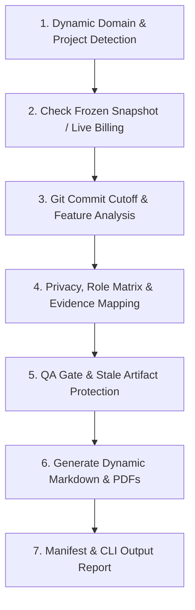

# Universal Evidence & Billing Package Generator (`/siasek-bos`)

Skill ini digunakan untuk membuat **Paket Dokumen Tagihan, Rincian Pemanfaatan Layanan, Pembaruan Fitur, dan Bukti Operasional Software** yang adaptif untuk berbagai jenis aplikasi:
1. **Aplikasi Presensi SIASEK** (Paket Dokumen Pendukung BOSP SMP Negeri 1 Biau).
2. **Aplikasi Apotek Sehat** (Paket Bukti Layanan Manajemen Obat, POS Kasir, Resep Racikan, & Laba Rugi).
3. **Aplikasi SaaS / Laravel Lainnya** (Otomatis mendeteksi `APP_NAME`, `APP_URL`, dan model billing proyek).

> [!IMPORTANT]
> - Skill ini menghasilkan **PAKET BUKTI PENYEDIA / LAYANAN** resmi dari ZahraDev (Emil Salim, S.Kom).
> - Untuk sekolah (SIASEK), paket ini berfungsi sebagai dokumen pendukung SPJ/LPJ BOSP.
> - **JANGAN** membuat bukti pembayaran. Bukti pembayaran dilampirkan oleh pihak pelanggan/sekolah/mitra.

---

## 1. Konsep Utama Keamanan & Pembekuan Tagihan (Billing Provenance & Safety)

1. **Auto-Domain & Profile Detection**:
   Generator secara cerdas mendeteksi profil domain aplikasi (`SCHOOL_BOSP`, `APOTEK`, atau `GENERAL_SAAS`) berdasarkan folder kerja dan file konfigurasi.
2. **Live Billing Snapshot (Bulan Berjalan)**:
   Pada bulan berjalan (`CURRENT_PERIOD`), kuantitas billing diambil dari aplikasi live atau metrik sistem aktif.
3. **Frozen Verified Snapshot**:
   Ketika billing dinyatakan `VERIFIED` dan lulus `QA PASS`, hasilnya dibekukan ke `evidence/<bosp|billing>/<YYYY>/<MM>-<bulan>/billing/billing-snapshot.json`.
4. **Historical Period Reuse**:
   Untuk bulan yang telah berlalu (`HISTORICAL_PERIOD`), generator mengulang penggunaan **Frozen Verified Snapshot** yang ada pada direktori target untuk menjaga integritas data historis.

---

## 2. Alur Eksekusi Automated Workflow

Saat perintah `/siasek-bos bulan <bulan> <tahun>` dipanggil (misal: `/siasek-bos bulan oktober 2026`):



---

## 3. Langkah-Langkah Eksekusi Skill

### Langkah 1: Run Automation Script
Jalankan helper script dari root repositori aplikasi manapun:

```bash
php .agents/skills/siasek-bos/scripts/generate_bosp_package.php --month=<bulan> --year=<tahun>
```
*(Atau jika dipanggil secara global via Antigravity, skrip otomatis mengarahkan ke root workspace aktif)*

### Langkah 2: Evaluasi Output & QA Status
- **Current Period**: Mengambil data LIVE, menyimpan `billing-snapshot.json` jika verified.
- **Historical Period**: Menggunakan `billing-snapshot.json` yang dibekukan. Jika tidak ada snapshot terverifikasi, QA status = `BLOCKED`.

---

## 4. Struktur Paket Output

Hasil eksekusi disimpan pada direktori: `evidence/bosp/<YYYY>/<MM>-<bulan>/`

```text
evidence/bosp/2026/09-september/
├── 01_invoice/
│   └── INVOICE_SIASEK_BIAU_SEPTEMBER_2026.pdf
├── 02_rincian_pemanfaatan/
│   └── RINCIAN_PEMANFAATAN_SIASEK_BIAU_SEPTEMBER_2026.pdf
├── 03_pembaruan_fitur/
│   └── PEMBARUAN_FITUR_SIASEK_BIAU_SEPTEMBER_2026.pdf
├── 04_screenshots/
│   ├── bukti_billing_september_2026.png
│   └── bukti_admin_leave_intervention_september_2026.png
├── 05_evidence_index/
│   └── EVIDENCE_INDEX_SIASEK_BIAU_SEPTEMBER_2026.pdf
├── billing/
│   ├── billing-snapshot.json
│   └── snapshots/
│       └── 2026-09-27.json
├── FINAL/
│   └── PAKET_BOSP_SIASEK_BIAU_SEPTEMBER_2026.pdf
└── manifest.json
```

---

## 5. Format Laporan Akhir CLI Output

```text
SNAPSHOT CREATED:
YES/NO

SNAPSHOT FILE:
...

STUDENT COUNT:
...

SNAPSHOT DATE:
...

FROZEN:
YES/NO

HISTORICAL REUSE:
PASS/FAIL

STALE ARTIFACT PROTECTION:
PASS/FAIL

AUGUST:
...

SEPTEMBER:
...

QA:
PASS/BLOCKED
```

